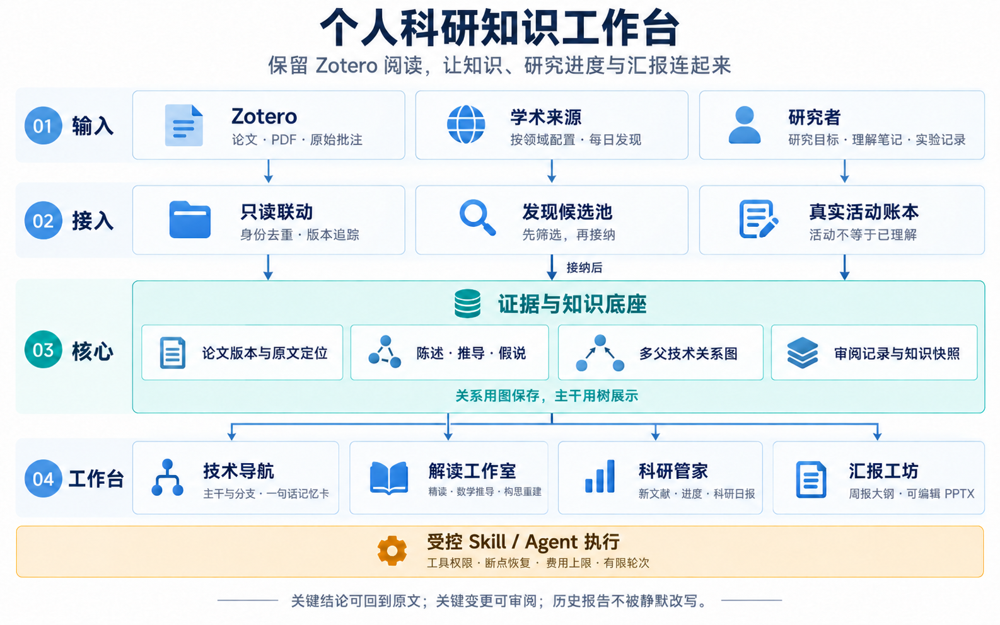

# 个人科研知识工作台：项目建议书

日期：2026-10-22。范围：开源选型、产品与项目经理交叉讨论、CTO 架构决策。本轮没有安装候选应用、读取个人 Zotero 库、创建每日自动化或完成软件实现。

## 核心判断

建议保留 Zotero 的阅读器、附件和原始批注，在其旁边建立以研究问题为中心的知识工作台。需要长期自己掌握的是“论文身份与版本、原文证据、知识主张、技术关系、用户确认、科研活动与报告快照”。通用聊天界面可以复用，这些科研数据不应依附某个聊天产品的私有结构。

快速原型可优先验证 AnythingLLM，Open Notebook 作为更偏研究工作区的备选；长期以自有领域层加可替换组件推进。不要把多个完整 AI 工作台全部装进一套系统，也不要因为有图检索就默认拥有可信技术谱系。

上述是基于文档与仓库核验的设计判断。团队未完成安装、性能或学术正确率测试，不能将候选的发布记录、测试文件、论文成绩当作本项目质量保证。

## 开源项目筛选

两名检索智能体分别完成 GitHub 路线和博客路线，共评估 13 个候选；主协调者额外核验 Docling、Zotero 官方接口和底层组件文档。详细出处及查询边界见 [GitHub 报告](research-github.md)、[博客报告](research-blogs.md)、[架构资料](architecture-source-notes.md)。

| 项目 | 复用位置 | 优点 | 缺点与可靠性判断 |
|---|---|---|---|
| [AnythingLLM](https://github.com/Mintplex-Labs/anything-llm) | 可替换的原型工作台 | MIT；已有文档问答、Agent、定时任务；2026-10 有发布 | 工程证据较充分，但技术谱系和科研质量控制需另做；未验证 Windows 下本项目组合 |
| [Open Notebook](https://github.com/lfnovo/open-notebook) | 研究工作区备选 | MIT；引用问答、笔记、转换、API；2026-10 有发布与 CI | 现为单用户；MCP agents/PPT 属愿景而非现成功能；迁入其存储需评估 |
| [PaperQA2](https://github.com/Future-House/paper-qa) | 科学检索与证据问答适配器 | Apache-2.0；有科学文献评测与证据处理设计 | 公开版与内部研究系统不完全一致；CalVer 不保证跨发布兼容；不能替代领域评测 |
| [GPT Researcher](https://github.com/assafelovic/gpt-researcher) | 外部研究与日报流程参考 | Apache-2.0；有多来源研究、引用与多 Agent 示例 | 通用 Web 调研需改成学术来源；引用存在不等于结论成立；必须限制循环与费用 |
| [kujenga/zotero-mcp](https://github.com/kujenga/zotero-mcp) | 窄范围 Zotero 工具适配器 | MIT；搜索、元数据、全文；有测试，2026-08 发布 0.3.1 | 不自带增量同步、技术图或回写冲突处理；MCP 不替代 Zotero 官方 API |
| [Docling](https://github.com/docling-project/docling) | PDF 结构与证据定位 | MIT；结构化文档、页码与位置来源；当前仍维护 | 扫描件、公式、跨页表格必须专项验证；代码与模型资源许可证分别核验 |
| [LangGraph](https://github.com/langchain-ai/langgraph) | 可恢复的解读/Skill 执行 | MIT；持久状态、中断和人工介入 | 是编排框架；幂等、预算、权限和知识正确性仍由项目负责 |
| [PptxGenJS](https://github.com/gitbrent/PptxGenJS) | 可编辑周报渲染 | MIT；原生文本、图表、表格、母版 | 不是审美或事实验证器；公式、字体和溢出需渲染检查，发布节奏较慢 |
| [Kotaemon](https://github.com/Cinnamon/kotaemon) | 精读证据界面与检索试验台 | Apache-2.0；PDF 高亮、混合检索、重排 | Windows 测试矩阵未启用；部分图检索依赖有兼容风险 |
| [Paperlib](https://github.com/Future-Scholars/paperlib) | 元数据/RSS/扩展设计参考 | GPL-3.0；贴近科研论文管理 | 用户已经使用 Zotero，整体替换收益有限；维护与单测证据较弱 |
| [Khoj](https://github.com/khoj-ai/khoj) | 科研助手与周期简报参考 | AGPL-3.0；个人知识与自动化场景贴近 | 最近抽查默认分支测试失败，需复验；不优先选作当前底座 |
| [Microsoft GraphRAG](https://github.com/microsoft/graphrag) | 关系候选生成与对照实验 | MIT；有文档、测试和研究基础 | 当前 README 明确维护模式；通用实体关系不等于技术继承，不选作谱系核心 |
| [ArxRec](https://github.com/pppoe/ArxRec) | 每日推荐反馈闭环的设计参考 | 个人实践展示低成本推荐、已读/略过反馈 | 未发现许可证，不能按许可明确的开源组件直接纳入；缺乏稳定性评测 |
| [Paper2Slides](https://github.com/HKUDS/Paper2Slides) | 从论文到逐页故事线的流程参考 | MIT；分阶段、可恢复流程 | 最后阶段是图像生成，样例是 PDF；不能等同于原生可编辑 PPTX |

这里的“工程证据较充分”只说明选型资料更扎实；科研答案正确率仍未知。具体 release、CI 和许可证链接保存在两份检索报告中。

博客路线的主要价值是补出宣传页没有充分表达的边界：[FutureHouse 工程文章](https://www.futurehouse.org/research/engineering-blog-journey-to-superhuman-performance-on-scientific-tasks)提供科学问答拆解和消融思路，但不能把内部实验成绩搬到公开版；[Assaf Elovic 的协作实践](https://www.langchain.com/blog/how-to-build-the-ultimate-ai-automation-with-multi-agent-collaboration)提供角色分工，但产品需要另加循环终止；[Aaron Taylor 的 Zotero MCP 实践](https://ataylor.io/blog/zotero-mcp/)支持保留阅读器、只增加连接层的思路；[Haoxiang Li 的每日推荐实践](https://blog.haoxiang.org/2024/02/personalized-arxiv-recommendation-service/)展示了反馈闭环，但没有证明大规模可靠性。

## 用户使用流程与产品共识

1. 连接 Zotero 的一个集合，选择一个研究问题。系统建立一份论文身份，多研究主题只是引用这份身份，避免再次制造重复文献库。
2. 读过的论文生成短记忆卡：一句话说明问题、核心办法与必要限制，配几个核心技术词；点开才能看到细节与原文证据。
3. 技术节点表示方法或原理，论文以提出、扩展、组合、采用、评估等角色挂接。底层保留多父关系，界面按研究问题显示主干和分支。
4. 主干由研究问题、代表性里程碑、明确方法承接证据和用户选择确定。多父节点选择主要展示父节点，其他关系保留；引用和相似不能自动变成继承。
5. 选择精读、数学推导或构思重建模板。输出明确区分论文陈述、系统推导和思路假说，声明实际读到了哪些材料、还有哪些缺口。
6. 每日发现先进候选池，自动去重、排序、生成摘要级草稿；用户收藏或窄范围规则接纳后再进入主题。必要时才升级全文精读。
7. 活动账本如实记录读完、理解笔记和复现实验，AI 解读完成不替代人的学习进展；没有记录不等于没有进展。
8. 日报、周报和 PPT 从同一份版本化内容包生成。机器候选、确认知识与待验证假说分开；幻灯片结论能回到当时的原文版本。

普通简介草稿可直接用于预览和检索；关键主干变化、概念合并、重大争议与成果声明重点核查。收藏、短卡与技术位置可以合并为一次操作，减少维护负担。

外部 SKILL 通过适配器接入：保留其任务指令与工作步骤，补齐输入/输出、证据要求、版本、工具权限和预算。首版支持用户保存和修改声明式模板，复杂团队采用有限的预设角色；任意代码插件和自由团队编排界面后置。已有精读或 PPT Skill 能否直接复用，取决于其所需工具在目标运行环境是否存在，不能只复制一份 Markdown 就承诺跨平台运行。

三名产品经理已各自进行实质问答并在两轮内收敛。A 接受 B 对逐篇全审成本的挑战，改为风险分层；C 接受 A 关于明确读完事件和新版不覆盖旧知识的约束；B/C 对齐了 AI 活动与人的理解状态，以及不可变报告引用。详见各经理记录。

## 最容易误解的质量边界

- “可点击引用”不等于“原文支持结论”：既要检查定位，也要由领域样本检验主张与证据是否匹配。
- “公式识别成功”不等于“推导正确”：保留假设、符号、每步依据和未解决步骤；数值检验或符号检查不是一般数学证明。
- “作者构思重建”是解释性假说：即使用户觉得有启发，也不能升级为作者的真实心理过程。
- “多 Agent 一致”不等于可靠：审阅者必须能看原文，讨论受轮次、时间、费用和无新证据终止约束。
- “本地优先”不等于全天在线：本地电脑离线时必须显示未执行并按策略补跑；按时日更需要常开执行端。
- “成功生成 PPTX”不等于可用周报：检查文件能打开、原生内容可编辑、文字不溢出、公式可读、引用完整。

## 工程架构、交付拆分与验收

图像使用内置图像生成工具制作，已检查文字与连线。该接口没有可核验的模型标识，不能确认是否为用户指定的 image2；[完整提示词](architecture-image-prompt.txt)和[生成记录](architecture-image-generation.md)一并保存。图展示逻辑模块，下面说明实际工程边界。

三名项目经理已经完成互评，CTO 最终采用本机 React/TypeScript/Vite 工作台 + FastAPI 模块化单体 + SQLite WAL + 单个后台执行 worker。领域库与执行/checkpoint 状态可用不同 SQLite 文件隔离；同一领域库保存知识、活动与快照，报告不做跨库事务。PPT 渲染作为后台子进程执行。[CTO 最终裁决](cto-architecture.md)记录详细责任、真实互评修订和统一估算。

| 负责人 | 核心观点 | 互评后的实质变化 |
|---|---|---|
| 产品经理 A：文献与技术链 | 先管好论文身份、版本和技术关系；图存储、树导航 | 接受 B 对逐篇全审负担的质疑，普通卡片草稿可直接预览；采纳 C 的合并确认操作 |
| 产品经理 B：精读与 Skill | 原文陈述、推导、构思假说分开；输出能暴露缺口 | 采纳 A 的来源类别区分，防止用户笔记被当作作者结论；与 C 统一材料范围与报告引用 |
| 产品经理 C：管家与 PPT | 每日提供可处理短名单，用真实记录组织汇报 | 不再从零散笔记或 AI 完成推断读完/理解；新版论文只提示复核，不改变旧报告 |
| 项目经理 A：数据与平台 | 正式知识只有一个写入入口，来源、证据、修订可追踪 | 接受 B 的固定逻辑幂等键与提交回执，避免重跑生成重复；接受 C 的一致快照和引用保留 |
| 项目经理 B：AI 与执行 | 一个执行器统一接收任务，检查点只管步骤恢复 | 把证据绑定到文档/解析版本；与 C 明确部分完成准入、补跑游标和外部重复计费的不确定窗口 |
| 项目经理 C：工作台与报告 | 用户看见真实状态；日报/PPT只读同一内容包 | 取消第二套重试/Agent系统，定时器只触发 B；报告固定一致快照并保留引用材料 |
| CTO | 先完成单用户、单主题闭环；控制范围与共享契约 | 统一三产品线字段与职责，将实现交给三项目经理互评，再合并工期和最终架构 |

所有交流均在两轮以内收敛，没有遗留需要继续循环的议题。尚需样本或部署条件决定的事项保留为试点任务，而非靠继续辩论得出确定答案。

### 工程模块如何配合

| 模块 | 具体作用与默认方案 | 实现难度 | 可靠性抓手 |
|---|---|---|---|
| 文献接入 | Zotero 官方 API，只读选择的集合；统一来源身份、论文版本与附件引用 | 中 | 重复同步不重复入库；本地/云端版本隔离；不用第二套文件夹复制原库 |
| 证据解析 | Docling 试点解析，保留原文、页码/位置、解析版本和材料缺口 | 中高 | 双栏、扫描、公式、表格专项样本；定位失效明确提示，不把 OCR 错误继续加工成确定答案 |
| 知识与技术图 | 自建论文、方法、主张、证据、关系、修订和主题视图；SQLite 关系表存多父图 | 高 | 原文支持、关系类型、人审关键边、修订冲突与撤销；图数据库后置 |
| 解读与 Skill | 基础混合检索，PaperQA2 对照试点；LangGraph 步骤状态 + 统一任务记录；三类受控模板 | 高，数学/构思语义不确定性最高 | 输入范围、权限、预算、原文审阅、两轮终止；机器结果先为补丁 |
| 发现与科研管家 | 单源发现、候选池、偏好反馈、真实活动；日程只触发统一任务执行器 | 中高 | 断网补跑、来源成功游标、去重、预算中止、无新结果与失败分开 |
| 日报与周报 | 一致领域快照生成 ReportBundle，再生成逐页内容和 PptxGenJS 输出 | 中高 | 历史不可变、来源映射、原生编辑、实际打开与渲染检查 |

一个后端内划清职责即可：A 的领域模块负责知识写入，B 的执行模块负责运行与恢复，C 的产品模块负责界面、触发和报告。后台解析与 PPT 不阻塞用户界面。所有模块共享契约，不能各自拥有另一套正式知识库或 Agent 调度器。

### 先验收什么

建议用约 20 篇用户已读论文、至少 100 条人工标注主张/定位、已知多父技术关系和一周科研活动建立试点集，留一部分材料不用于调提示词。验收同时包含：

1. 数据安全：重复导入、重跑与崩溃恢复不产生重复正式对象，旧任务不能覆盖新修订，备份能实际恢复。
2. 内容依据：引用既能定位，又真正支持主张；保留关键条件；区分摘要级与全文级输出，假说不冒充原文事实。
3. 技术图：组合方法保留多父边；用户可解释、修改和撤销主干；引用和相似关系不会自动升级为方法继承。
4. 管家行为：打开 PDF/AI 任务完成不增加人的已读或理解记录；无记录不编造进展；限流和断网显示失败而非“无新论文”。
5. 报告产物：旧报告仍指向原来的版本；PPT 在实际目标软件打开、渲染和抽样编辑，检查文字、表格、单位、公式与引用。

工程组提出的 95% 定位/原文支持率只是需校准的讨论目标，不是本次实测结果，也不代表小样本能证明生产准确率。严重错误不能被平均分抵消：例如缺全文却编造实验、思路假说冒充作者陈述、已确认知识被覆盖，应阻断相关能力放行。

### 分期与投入

CTO 统一估算基准：3 名熟悉相关栈的全职工程师、约 0.5 人测试/设计支持、研究者每周 4–8 小时。工程工作量约 19–28 人周，含额外联调与流程验证；按依赖安排，8–12 个日历周形成受限试点。两人或单人兼职团队需要重新估算，不能沿用此工期；它也不是质量或交付保证。

| 阶段 | 规划窗口 | 可检查的出口 |
|---|---|---|
| 样本与接口试验 | 第 1 周 | Zotero 接入、Windows 解析、复杂公式/PPT 模板试验；最多 3–5 天 AnythingLLM 原型验证 |
| 已有论文闭环 | 第 2–5 周 | 一篇论文到证据、记忆卡、可编辑技术位置和确认记录完整连通 |
| 管家与汇报闭环 | 第 5–8 周 | 三受控解读模板、单源候选、活动账本、日报和可编辑周报连通 |
| 故障与质量试点 | 第 8–12 周 | 断网/崩溃/预算/取消、备份恢复、留出样本核查和 PPT 编辑检查通过；公布真实成本与错误类型 |

后续再扩展更多发现源、多主题布局、更自由的 Agent 团队配置和常开部署。常开端不能直接访问本机 Zotero 附件，需要授权 Web 路径或明确的本地同步桥；多人写入时再评估迁移 PostgreSQL，图查询实测成为瓶颈时再考虑图数据库。

最值得先验证的是：选一个熟悉方向的 20 篇论文，用它们打通“Zotero → 证据 → 记忆卡 → 技术位置 → 一次可编辑周报”。这会暴露项目真正难点，之后再扩大每日抓取和自动解读。

## 本轮完成情况

2 名检索智能体、3 名产品经理、3 名项目经理、1 名 CTO 均已完成各自工作；产品讨论先交 CTO，工程组依据 CTO 契约完成互评，再由同一 CTO 作最终裁决。所有来源、观点及修改记录保存在本目录。图像已生成并核查；文档本地链接已检查。软件的安装、集成、领域评测及生产验收尚未进行。
